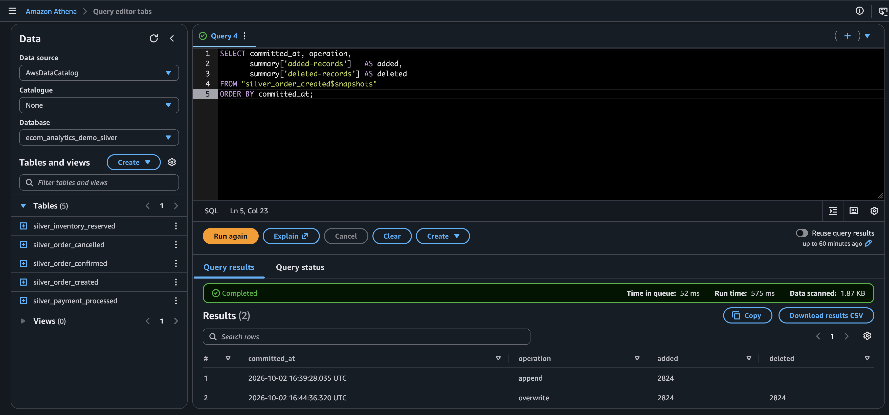
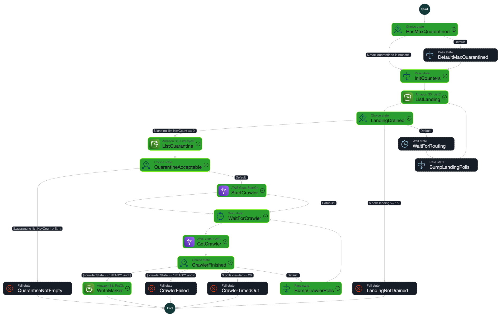
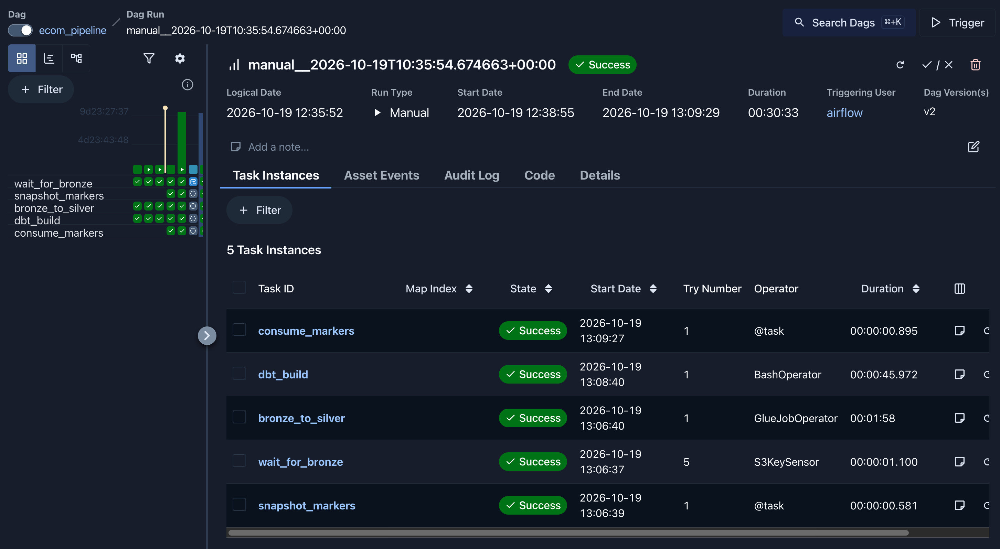
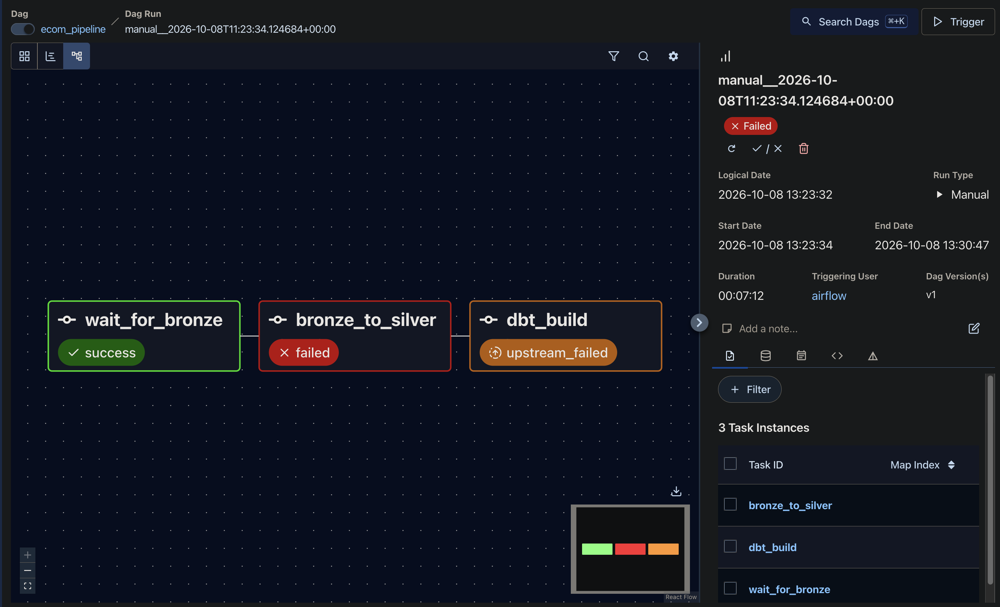
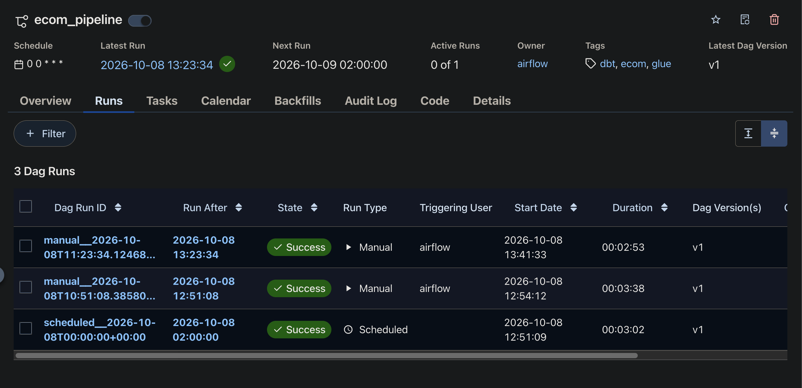

# AWS-Native Data Platform

A medallion pipeline on AWS managed services: files land in S3, **Lambda and Step Functions** validate them into bronze, **Glue (PySpark)** builds **Apache Iceberg** silver tables, **dbt on Athena** builds gold, **Airflow** orchestrates the transform, and **Terraform** provisions the AWS side.

The point of the project is not that the pipeline runs. It is that each design choice was **tested until it failed, then fixed**, and the failures are documented below with the evidence.

## What this demonstrates

| Skill | Where to look |
|---|---|
| Event-driven ingestion: Lambda validates each file, Step Functions closes the batch | [Ingestion](#ingestion-lambda-and-step-functions) |
| Glue PySpark ELT into Iceberg, with idempotent merges | [Silver job](#a-guarded-merge-still-rewrote-the-whole-table) |
| Data quality enforced in code, each rule seen to fire | [40 validity rules](#data-quality-is-enforced-at-silver) |
| Iceberg internals: snapshots, delete files, compaction, time travel | [Two engines, two write modes](#two-engines-two-write-modes) |
| dbt on Athena: staging, marts, source and reconciliation tests | [Gold layer](#gold-layer-dbt-on-athena) |
| Orchestration with retries and failure handling | [Airflow](#orchestration-airflow) |
| Terraform for S3, IAM, Glue, Athena | `terraform/` |
| Honest scoping | [What is not proven](#what-is-not-proven) |



## Where the data comes from

The seed is the archived output of a companion project,
[real-time-ecommerce-platform](https://github.com/Liz0007/real-time-ecommerce-platform),
a Kafka-based event-driven system whose `data-pipeline` service writes every event to a data lake.
**11,296 events across five topics**, covering 2,824 order lifecycles, are exported here and committed, so this repo stands alone.

This is **real output of a running system under simulated load**, not production traffic: the payment failure rate is a setting in that system, and the run contained **no redelivered (duplicate) events**. It gives realistic schemas and event relationships, not realistic scale or messiness.

| Topic | Records |
|---|---|
| `order-created` | 2,824 |
| `payment-processed` | 2,824 |
| `inventory-reserved` | 2,824 |
| `order-confirmed` | 2,329 |
| `order-cancelled` | 495 |

## Architecture

```
data/seed/lake/            committed seed, exported from the platform
        │ upload
        ▼
   S3  landing/            producers drop JSONL here
        │  S3 event
        ▼
   Lambda                  validate each file (structure), route it
        ├──► S3 quarantine/ (+ quarantine-reasons/)     invalid files
        ▼
   S3  bronze/             raw JSONL, Hive-partitioned by topic_name + event_date
        │
   Step Functions          wait for landing to drain · refuse if quarantined ·
        │                  run the bronze crawler · write markers/bronze/*.success
        ▼
   Glue Data Catalog       bronze table (crawled)
        │
        │   Airflow waits for the marker, then:
        ▼
   Glue PySpark job        parse · type · validate · dedupe · delta-merge
        │
        ▼
   S3  silver/             Iceberg tables, one per topic
        │
        ▼
   dbt (dbt-athena)        staging (ephemeral) → marts (Iceberg), tests at every layer
        │
        ▼
   S3  gold/               fct_orders · daily_order_metrics · payment_failure_reasons
        │                  · stock_held_for_cancelled_orders
        ▼
   Athena                  ad-hoc queries over every layer

   Airflow (local Docker):  marker sensor ──► Glue job ──► dbt build     @daily
                            Glue job --COMPACT true                      @weekly
```

## Run it

Prerequisites: AWS credentials in `~/.aws`, Terraform, Docker, Python with dbt. The region is `eu-south-2`.

```bash
cd terraform && terraform init && terraform apply     # S3, IAM, Glue, Athena
./scripts/upload_seed_to_landing.sh                   # seed → landing/; Lambda routes it to bronze/
./scripts/close_bronze_batch.sh                       # crawl + write the marker Airflow waits for
./scripts/run_dbt.sh build                            # gold, standalone

./scripts/make_airflow_env.sh                         # airflow/.env from terraform output
cd airflow && docker compose build && docker compose up airflow-init && docker compose up -d
# UI: http://localhost:8080 (local-only login: airflow / airflow)
```

## Key design decisions

### Ingestion: Lambda and Step Functions

Everything before bronze is event-driven; everything after it is orchestrated by Airflow. The two tools do different jobs:

- **Lambda, per file.** Each object landing under `landing/` triggers a Lambda that checks its *structure*: every line is a JSON object with the six envelope fields, of the right types, on the topic its path names. A valid file is written to its bronze partition; an invalid one is copied, byte for byte, to `quarantine/` with the reasons in `quarantine-reasons/`. A replay of identical bytes rewrites the same keys, but a *different* file that would land on an existing bronze key (same topic, event date and file name) is quarantined with a "name collision" reason instead of overwriting it. It takes `event_date` from the records' own `ingested_at`, so a file replayed next week lands in the same partition. A file that crosses midnight is split across two.
- **Step Functions, per batch.** A state machine waits for `landing/` to drain, **fails with `QuarantineNotEmpty` if anything is quarantined**, runs the bronze crawler, and only then writes `markers/bronze/<execution>.success`. Airflow's sensor waits for that marker, so the transform never starts on a half-landed or incomplete batch.

Content is not checked here. A row with a null order id is structurally fine, reaches bronze, and is stopped by the silver rules, which keeps bronze a faithful, replayable record. [The full design, including the limits, is in `docs/trigger-design.md`.](docs/trigger-design.md)

**What has been verified, and where.**

- *Offline:* 26 unit tests on the Lambda, where five deliberate breakages of the code were each caught; 7 failure-injection tests (a failure between date partitions, a failed landing delete after bronze or quarantine was written, bronze name collisions, and an oversized file rejected before its body is read), where the two collision tests failed against the earlier handler before the fix; and 8 tests that run the state machine's real definition through a small interpreter with the AWS calls mocked (every exit: clean, quarantined, landing never drains, crawler fails or times out).
- *In AWS, happy path:* uploading all 296 seed files twice (592 routing events, no errors, nothing quarantined) left bronze with the same 296 keys it had before, so routing is idempotent. The batch-close state machine then succeeded, including its crawler polling loop, and wrote its marker:



- *In AWS, failure path:* `scripts/test_ingestion.py` drops three structurally bad files (malformed JSON, a missing envelope field, a record for the wrong topic). All three were quarantined with a reason naming the exact problem (for example `line 2: not valid JSON` and `missing field 'offset'`), and none reached bronze. The next batch close then **failed with `QuarantineNotEmpty` and wrote no marker**. After the test files were removed, the same state machine succeeded and wrote one.

### Bronze is one table; silver is five

Every topic shares one envelope at bronze: `topic`, `partition`, `offset`, `kafka_timestamp`, `ingested_at` and an unparsed `payload`. Five tables would differ only in name, so bronze is one table partitioned by topic. Silver parses `payload`, and there the schemas diverge (`order-created` has `customer_id` and `total_amount`; `payment-processed` has `failure_reason`), so silver is one table per topic.

Each silver table is keyed on `(kafka_partition, kafka_offset)`. That is only unique *within* a topic, which is sufficient because each topic has its own table.

### Partition keys must not collide with record fields

Bronze is partitioned by `topic_name`, not `topic`, because every record already contains a `topic` field. With `topic=` the crawler registered the column twice and Athena rejected the table: `HIVE_INVALID_METADATA: Table descriptor contains duplicate columns`. Renaming the partition key was the right fix, since bronze exists to preserve exactly what upstream emitted.

### The crawler inferred `payload` as a struct

The crawler inferred `payload` as a struct, the union of all topics' fields (14), because the topics share one table. `from_json()` needs a string, so the job checks the inferred type at runtime and serialises a struct back to JSON first. The union is also the concrete reason silver splits by topic.

### A guarded MERGE still rewrote the whole table

The first silver write was a `MERGE INTO` whose update branch was guarded so only changed rows would be touched:

```sql
WHEN MATCHED AND (NOT (t.status <=> s.status) OR ...) THEN UPDATE SET ...
```

Rerunning the job over identical data and reading the snapshot history showed otherwise:

| committed_at | operation | added_records | deleted_records |
|---|---|---|---|
| 16:39 | append | 2824 | |
| 16:44 | overwrite | 2824 | 2824 |

All 2,824 rows were rewritten to produce an identical table. The `AND` condition decides what a row becomes, not whether its file is touched: on a full reprocess every key matches, so every file is rewritten.

The fix computes the delta in Spark first: new keys by anti-join, and existing keys whose values differ by null-safe comparison. Only that delta reaches the `MERGE`, and an empty delta skips the merge entirely. Reruns now log `unchanged ... nothing written` and add no snapshots.

### Deduplication is deterministic

The upstream platform delivers at-least-once, so the same `(partition, offset)` can arrive twice. Spark's `dropDuplicates()` keeps an arbitrary copy, which would make output depend on scheduling. Instead each key keeps the row with the **earliest `ingested_at`**, with a content hash as tie-breaker, so two runs over the same input always agree.

This has been verified to be deterministic, but **it has never removed a row**: the seed contains no duplicates. See [What is not proven](#what-is-not-proven).

### Data quality is enforced at silver

| Layer | Role | Bad data |
|---|---|---|
| Ingestion | Structure: valid JSON, envelope fields and types, topic matches path | File quarantined whole |
| Bronze | None: stores exactly what arrived and passed ingestion | Kept, so it can be replayed |
| Silver | Validity: schema, types, required fields, allowed values, ranges | Fails the run |
| Gold | Business logic across tables | Caught by dbt tests |

`from_json()` and casts never raise: an unmatched field or a bad cast silently becomes null. Without explicit rules, an upstream schema change would land as nulls. The job therefore checks, per topic:

| Topic | Rules | What they cover |
|---|---|---|
| `order-created` | 7 | required fields, allowed status, `total_amount > 0`, no future timestamps |
| `payment-processed` | 12 | required fields, allowed status / method / failure reason, `amount >= 0`, a failure has a reason and a success has none |
| `inventory-reserved` | 7 | required fields, allowed status, `expires_at` after `reserved_at` |
| `order-confirmed` | 7 | required fields; confirmed implies payment succeeded and stock reserved |
| `order-cancelled` | 7 | required fields and allowed values |

An empty bronze also fails the run (`MIN_BRONZE_ROWS`).

**Each of the 40 rules was seen to fire.** `scripts/test_validity_rules.py` injects one bad row per rule into bronze (plus control rows that must pass), runs the real Glue job with zero tolerance, and checks the failure names exactly that rule. All five topics passed, a clean rerun recovered, and no bad row reached silver. `--dry-run` prints the plan without touching AWS.

### Two engines, two write modes

Iceberg supports copy-on-write (rewrite whole data files) and merge-on-read (write small delete files, apply them at read time). The two engines in this project do not behave the same:

- **Athena** always uses merge-on-read for `UPDATE`, `DELETE` and `MERGE`, and ignores copy-on-write table properties (per the AWS documentation).
- **Spark** follows the table properties. The Glue job set none, and its `MERGE` behaved as copy-on-write.

So one table accumulates both kinds of write. This was exercised end to end on the silver tables:

1. In Athena, `DELETE` one partition (149 rows) and `UPDATE` 86 rows.
2. Rerun the Glue job. It repaired the damage, logging `inserted 149, updated 86`.
3. The table's history then showed the cost: for `silver_order_cancelled`, **730 physical rows, 235 of them hidden by delete files, 495 live**.
4. `rewrite_data_files` (the job's `--COMPACT true` mode) produced a `replace` snapshot with **1 data file, 0 delete files, 495 records**.

That is why compaction is an explicit, scheduled step (the weekly Airflow DAG), not a side effect of writing Parquet through Iceberg. Table format version is 2.

### Finding: 233 orders were cancelled before their stock was resolved

Of the 495 cancelled orders, **233 have `inventory_status = NULL`**. Payment and inventory are processed in parallel upstream; when a payment fails first, the order is cancelled before the inventory result arrives. Every order eventually produced an `inventory-reserved` event, so 233 reservations were made *after* the order was already cancelled: stock held for orders that no longer exist. The silver rules treat the null as valid, and the gold layer measures it (`reserved_after_cancellation = 233`).

### Gold layer: dbt on Athena

Staging models are `ephemeral`; marts are Iceberg tables. Tests are of three kinds:

- **Source tests** on the five silver tables: `unique`, `not_null`, `relationships`.
- **Mart tests**: 8 generic tests.
- **Singular tests across tables** (for example `assert_payment_matches_order_total`, `assert_every_order_resolved`, `assert_daily_metrics_reconcile`): 6 in total.

A clean build is `PASS=32` (models and tests). The gold numbers reconcile: 2,824 orders, 2,329 confirmed, 495 cancelled, 0 pending, cancellation rate 0.1753, 495 payment failures, and a revenue difference between orders and payments of 0.00.

**Break-and-repair, with what actually happened:**

| Tamper | Result |
|---|---|
| Changed one payment amount in silver | `assert_payment_matches_order_total` failed, 8 downstream nodes skipped. Rerunning the Glue job logged `inserted 0, updated 1`; dbt back to `PASS=32`. |
| Deleted one order from `silver_order_created` | Source tests failed: `PASS=12 ERROR=3 SKIP=17`. Gold stayed at 2,824 orders (it never built from the damaged source). Glue repair logged `inserted 1`. |

**A limitation this exposed:** a failing test on a gold table does not stop that table from being built. In the first tamper, the mismatching `fct_orders` row **was published**, and only downstream models were skipped. Source tests are the ones that gate gold. Making a cross-table assertion block publication would mean moving it to the source (silver) layer; that is untested.

### Orchestration: Airflow

Airflow runs locally in Docker (LocalExecutor, Postgres metadata), with the UI bound to `127.0.0.1` only. Credentials come from `~/.aws`, mounted read-only; nothing is baked into the image. dbt runs from its own virtualenv in the image so its pins cannot conflict with Airflow's. `requirements-dbt.txt` is a `pip freeze` of the environment where `dbt build` passed. The image build fails if it has no `dbt-core==` line, which only catches the unedited template; pip itself rejects conflicting duplicates and incompatible sets, and `dbt --version` inside the container reports the pinned versions (core 1.12.5, athena adapter 1.11.1).

| DAG | Schedule | Tasks |
|---|---|---|
| `ecom_pipeline` | `@daily` | `wait_for_bronze` (marker sensor) → `snapshot_markers` → `bronze_to_silver` (Glue) → `dbt_build` → `consume_markers` |
| `ecom_compaction` | `@weekly` | Glue job with `--COMPACT true` |

The sensor waits for the ingestion marker. The DAG records which markers exist when it starts and deletes exactly those after dbt succeeds, so a batch closed mid-run is not lost and a failed run keeps its markers. What this does and does not guarantee is spelled out under [Guarantees and limits](#guarantees-and-limits-of-the-marker-handoff). Both DAGs are created paused. A manual run of `ecom_pipeline` succeeded end to end in 3m38s with no retries.

**Marker handoff, observed.** A run triggered with no marker present held at `wait_for_bronze` for 28 minutes, poking once a minute. Closing a batch (`scripts/close_bronze_batch.sh`) wrote a marker, and the sensor passed within a minute. `snapshot_markers` recorded it, Glue (1m58s) and dbt (46s) ran, and `consume_markers` deleted it, leaving `markers/bronze/` empty. Earlier, a scheduled run of the same DAG version had consumed two markers left from the ingestion tests without anyone watching.



**Failure path, observed.** One row with a null `order_id` was placed in bronze. The Glue job reported `order-created: 2825 rows, 1 invalid (0.04%), 7 rules` and raised:

```
ValueError: order-created: 1/2825 rows (0.04%) broke validity rules,
above the limit of 0.00%: order_id is null (1)
```

Airflow resubmitted a fresh Glue run for each retry (four attempts in total), all failing identically, and the run stayed failed. After removing the row and clearing the failed task, the same run completed.




**Known wart:** retries repeat every failure, including deterministic data-quality failures, so a bad-data run fails four times before it surfaces. Transient Glue errors are the reason retries exist; separating the two would mean classifying errors.

### Guarantees and limits of the ingestion Lambda

- **Retries converge.** The landing object is deleted last. A failure before that leaves it in `landing/`, so the batch cannot close on it, and the retry ends in the same state as a clean run. This is tested by injecting a failure between a file's two date partitions, after the bronze writes, and after the quarantine copy.
- **A partial result can be seen briefly.** A file that crosses midnight writes one partition at a time, so the first partition is readable until the retry writes the rest. The batch marker is not written meanwhile, but a direct query of bronze, or a Glue run already in flight, can see the partial state; the next run's merge picks up the remainder.
- **Different files never overwrite each other in bronze.** Bronze keys do not include the landing date folder, so the handler compares any existing object first and quarantines a file whose bytes differ, writing nothing for any of its dates. Replacing a bronze file on purpose means deleting the old object first. The Lambda role has read access to `bronze/*` for this check.
- **Verified in AWS, accept side:** after deploying the check, replaying all 296 seed files into `landing/` routed every one (296 `routed` log lines, 0 quarantined, the same 296 bronze keys, rewritten with fresh timestamps). Each replay read the existing bronze object through the new permission and found identical bytes.
- **Not covered:** the reject side (a *different* file landing on an existing key) is unit-tested only; `test_ingestion.py` has not been extended to exercise it in AWS, because that needs a valid file in bronze. After async retries are exhausted there is no dead-letter queue; the file stays in `landing/` and the batch fails with `LandingNotDrained`.

### Guarantees and limits of the marker handoff

The marker is a **readiness gate, not a batch selector**. The Glue job is given no marker list; it reads the whole bronze table and merges whatever silver does not yet have. The guarantee is therefore *at-least-once processing with idempotent transforms*, not batch isolation.

- **A run may process more than its markers cover.** Files that land after the snapshot but before Glue reads bronze are picked up early; their marker stays and triggers a later run that finds nothing new. If strict per-batch isolation were required, the snapshot keys or a batch id would be passed to Glue as a job argument and used to filter the read. That is not built, because the idempotent merge makes it unnecessary here.
- **A marker that arrives after the snapshot waits for the next run.** `consume_markers` deletes only the snapshot, so the marker survives; it is deferred, not skipped. Latency is bounded by the `@daily` schedule. A more frequent schedule is safe (`max_active_runs=1` prevents overlap). With no marker at all, the sensor times out after 2 hours and the run fails loudly.
- **Recovering a failed run.** A failed run never consumes its markers. Clearing only the failed task and its downstream reuses the original snapshot; clearing `snapshot_markers` takes a new one. Either is safe because the snapshot is taken before Glue starts, so the markers consumed at the end are always ones that existed before the Glue read. This reasoning is not yet tested (see below).
- **The steps are not one transaction.** Marker listing, Glue, dbt and marker deletion are separate operations. If dbt fails, the markers are kept and the rerun repeats Glue. If dbt succeeds but deletion fails, the next run reprocesses the same data. Both are harmless only because the silver merge and the gold rebuild are safe to repeat; the silver side is evidenced (the recovered run after the injected bad row), the gold side is not yet.

**Why the transform is not triggered per object.** The obvious design (an S3 `PutObject` starts the pipeline) does not survive a real stream: the upstream service flushes every 10 seconds across five topics, about 43,000 objects a day, which would mean 43,000 Glue starts of one to two minutes each. Lambda is cheap per file, but Glue is not, so the unit that triggers the transform is the *batch marker*. Reprocessing is safe because the writes are idempotent. Each run currently rereads all of bronze (cheap at this volume); larger data would narrow the read by `event_date` partition. Glue job bookmarks are deliberately off because they apply to DynamicFrame reads, not the `spark.table` read this job uses.

The production equivalent of this setup would be Amazon MWAA (managed Airflow), which is not deployed here.

### Two Glue details that cost a failed run each

- **`--enable-glue-datacatalog`.** Without it, `spark.table("db.table")` resolves against an empty local metastore and the crawled table is invisible (`TABLE_OR_VIEW_NOT_FOUND`), although Athena queries it fine. It is separate from the Iceberg catalog configuration.
- **No PySpark column expressions at module level.** `F.col(...)` needs an active SparkContext. Built at import time it fails with a bare `AssertionError`. The per-topic column projections are therefore functions, evaluated once Spark exists.

## What is not proven

- **Deduplication has never removed a row.** The seed has no duplicates; the guarantee is deterministic but untested against real duplicates.
- **Scale.** 11,296 events in effectively one date partition says nothing about large-volume behaviour.
- **`inventory_unavailable`.** That path never occurs in the data, so its rules only run on rows from the injection test.
- **Extra rows added to silver by hand** are not removed by the job. This is inferred from the code, not tested.
- **Recovery from a cleared task.** Clearing only `dbt_build` (reusing the snapshot) and clearing `snapshot_markers` (re-listing) should each end with an empty `markers/bronze/`. This follows from the design but has not been run.
- **Gold is safe to rebuild twice.** Running `dbt build` twice in a row and comparing row counts has not been done.
- **Quarantine is counted in total, not per batch,** so it must be emptied before the next batch can close.
- **Airflow runs locally.** Nothing here proves the DAGs on MWAA.

## Status

| Phase | Status |
|---|---|
| Seed data exported from the platform | ✅ |
| Terraform: S3, IAM, Glue Catalog, bronze crawler, Athena, Glue job | ✅ |
| Glue job: bronze → silver (Iceberg), 40 validity rules, compaction | ✅ |
| dbt: silver → gold, tested, break-and-repair verified | ✅ |
| Airflow: pipeline and compaction DAGs, failure path observed | ✅ |
| Ingestion: Lambda validation + Step Functions batch close | ✅ happy and failure paths verified in AWS |
| Airflow gated on the ingestion marker | ✅ verified live: blocked without a marker, released on batch close, marker consumed after dbt |
| Redshift Serverless | ⬜ optional |
| Offline CI (`terraform validate`, `dbt parse`, rule-test dry run) | ⬜ |

## Cost

S3 holds megabytes, Athena bills about $5 per TB scanned, and Glue bills per DPU-hour for runs lasting a few minutes. Lambda and Step Functions sit inside the free tier at this volume. The hourly batch-close schedule is **off by default**, because each run starts a crawler; enable it with `ingest_schedule_enabled = true`. A full build-and-demo cycle costs a few dollars at most. Airflow runs on your own machine, so it adds no AWS cost, but Glue runs it starts do.

## Layout

```
terraform/   S3, IAM, Glue (crawler + job), Athena, ingestion Lambda + state machine
lambda/      ingest_validate: validation.py (pure logic), handler.py (S3 routing)
tests/       Lambda unit tests, state machine control-flow tests
glue/jobs/   bronze_to_silver.py
dbt/         staging, marts, tests, profiles (athena adapter, no credentials)
airflow/     Dockerfile, docker-compose.yml, dags/
scripts/     seed export/upload, validity-rule injection test, run_dbt.sh, make_airflow_env.sh
data/seed/   committed event archive
docs/        screenshots
```